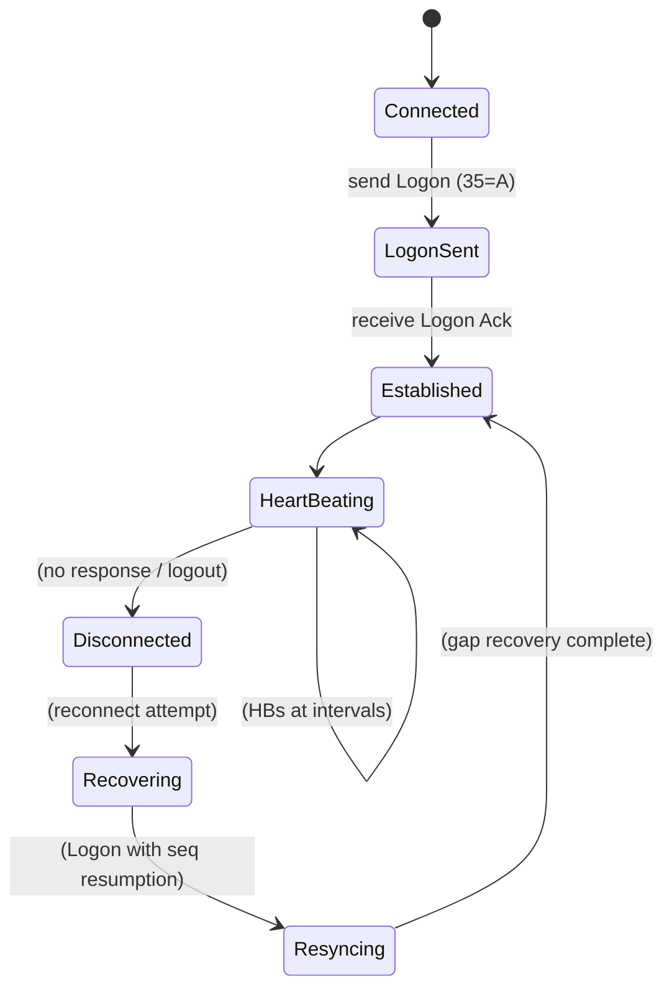

# Executive Summary  
The **FIX Protocol** has long been the universal standard for electronic trading connectivity, offering a mature, interoperable tag-value format used by brokers, exchanges, and institutions worldwide.  However, modern trading systems must also integrate many **non‑FIX connectivity** methods – exchange-specific binary APIs, proprietary broker interfaces, REST and WebSocket endpoints, and RFQ/quote systems – to achieve full market coverage, optimal latency, and new asset types.  This report analyzes the **trading connectivity landscape**, detailing FIX fundamentals and session mechanics (with sample FIX messages and common tags), then examining the end-to-end order/execution workflow over FIX (new orders, fills, cancels, rejects, drop‑copies, etc.) with a mapping to internal order states.  We propose an **internal normalized model** and adapter architecture (with a canonical API and event bus) to hide heterogeneity and ensure consistency.  Broker/exchange **non-FIX adapters** (REST, WebSocket, RFQ, etc.) are surveyed with examples, and we discuss engineering such adapters (dialects, custom tags, behavior quirks, certification).  Connectivity **infrastructure** requirements (session management, journaling, HA, monitoring, kill-switches) are described, and we compare **buy vs build** strategies for market connectivity with a decision table.  Finally, we give concrete **recommendations and best practices** for designing an OMS/EMS with a single reliable internal interface that abstracts external protocols, plus a sample **troubleshooting playbook** for common session failures. The appendix lists key protocol specifications and tools for further reference.  

## 1. Connectivity Landscape  
Market access employs a variety of protocols and APIs beyond FIX.  Although FIX (Financial Information eXchange) is deeply embedded in broker‐to‐client order flow, drop copy and routing systems, many venues and brokers also provide *proprietary* or *optimized* interfaces:  

- **FIX Connectivity:**  Widely used by brokers and venues for order entry and execution reporting. FIX’s tag-value format is flexible and human-readable (simple to log/debug).  It supports many message types (orders, executions, market data, etc.) and is extensible via custom tags. Its certification process and tooling are mature, and it greatly reduces protocol fragmentation across multi-venue trading.  

- **Exchange-Native Protocols (Binary APIs):**  Many exchanges offer low-latency binary order entry and market data feeds.  Examples include CME’s **iLink3** (binary FIX), **FAST/SBE** market data (Globex MDP), Eurex **ETI**, LSE **RFA**, Nasdaq **OUCH/ITCH**, ICE **BOE**, B3 (Brazil) binary protocols, etc. These use fixed schema messages (often encoded via SBE/FAST) to minimize size and parsing overhead. Proprietary APIs give exchanges more control to introduce new order types rapidly, and can yield lower tail latency under heavy load.  

- **Proprietary Broker APIs:**  Some brokers offer custom APIs (often over TCP or via messaging) that may use FIX or an OEMS (order management system) protocol. For example, Interactive Brokers has its **TWS API** (native sockets/JSON), E*Trade has REST, etc. Proprietary APIs may expose additional features (market analytics, algo engines, custom fields) not covered by standard FIX. They often follow a request/response or streaming model (see below).  

- **REST and WebSocket APIs:**  Increasingly common, especially in **crypto** and retail markets. Many crypto exchanges (Coinbase, Binance, Kraken) and modern brokerages provide HTTP REST for order entry/status and WebSocket streams for market data and order updates. For instance, Coinbase Prime offers a FIX gateway *or* REST/WS interfaces; their docs note that REST is “more intuitive” but FIX gives deterministic sequencing.  A layered approach is common: FIX for high-speed order entry; WebSockets for real-time data; REST for batch operations. Crypto venues often support all: e.g. Binance Prime has a FIX API (for institutional spot trading), plus a JSON REST and WS feed. Using REST/WS can ease client development, but introduces the usual HTTP semantics (request/response, statelessness) and may not guarantee order sequence.  

- **RFQ Protocols and Quote Systems:**  In RFQ or multilateral negotiation contexts (FX voice/RFQ, corporate bonds, swaps), messages like **QuoteRequest (35=R), Quote (35=S)** and **MarketData/IndicativeQuote** are used. FIX supports RFQ workflows where a client requests quotes from multiple dealers. Some markets may use proprietary RFQ systems (e.g. Bloomberg terminals) or message-based systems (e.g. RFS/FAST for aggregate data).  

- **Drop-Copy Connectivity:**  A “drop copy” feed is a dedicated stream (often FIX tag-value) that duplicates all fills/cancels for compliance or back-office.  A sell-side firm might run two FIX sessions to a client: one for the client’s own orders (orders/fills only for that client) and another drop-copy session that “drops” all executions (from any source) into the client’s risk systems.  

- **Market Data vs Order Connectivity:**  Market data feeds (best bids/offers, depth, trades) are almost always separated from order entry.  Exchanges typically multicast or broadcast market data via UDP or high-performance TCP (often using FAST/SBE codecs) to all participants.  Order/trading connectivity is unicast (point-to-point TCP/FIX or binary) with session guarantees.  Keeping data and orders separate simplifies scaling and allows specialized tuning (e.g. UDP multicast for data, reliable TCP for orders).  

- **Reasons for Non-FIX:**  Exchanges and brokers may choose proprietary protocols for *performance* (optimized binary encoding, co-location, minimal padding), for *legacy reasons* (older systems), or to add advanced features (market depth, auctions) not yet standardized in FIX.  High-frequency trading firms often use direct binary APIs for sub-microsecond determinism. In other cases, the venue’s core matching engine was built around a proprietary protocol and adding FIX support is non-trivial.  Thus, while FIX is the lingua franca for order entry at a macro level, **non-FIX connectivity remains critical** for ultra-low latency and full market coverage.  

The table below summarizes key protocol categories:

| Connectivity Type           | Examples                                     | Typical Use-Cases                |
|-----------------------------|----------------------------------------------|----------------------------------|
| **FIX (Tag-Value)**         | FIX 4.x/5.x sessions to brokers/exchanges    | Order entry, executions, drop-copy (multi-venue routing) |
| **Proprietary Binary APIs** | CME iLink 3, ITCH/OUCH, Eurex ETI, ICE BOE  | Direct market access (DMA), HFT; very low-latency order entry and market data |
| **Broker Proprietary APIs** | Interactive Brokers API, TT Order API, etc.  | Broker-specific features, single-dealer platforms |
| **REST (HTTP/JSON)**        | Alpaca, OANDA, modern crypto exchanges       | Bulk/trading actions, administrative (account, transfers) |
| **WebSocket Streams**       | Coinbase WS, Binance WS (JSON)               | Real-time market data and order status (UI or light apps) |
| **RFQ/Quote Messaging**     | FIX QuoteRequest/Quote, MarketDataSnapshot    | Request-for-quote workflows (FX/OTC markets) |
| **Drop-Copy (FIX)**         | Secondary FIX session with *DropCopyFlag*    | Post-trade feeds for risk/compliance; duplicate executions |

## 2. FIX Protocol Fundamentals  
FIX messages consist of a *Header*, *Body*, and *Trailer*. Each field is a `<tag>=<value>` pair delimited by SOH (ASCII 0x01), though for readability we often use `|` or `^` in examples. The standard header fields (e.g. tags 8=BeginString, 9=BodyLength, 35=MsgType) identify protocol version, length, and message type.  For example: 

```
8=FIX.4.4^9=176^35=D^49=CLIENT1^56=EXCHANGE^34=215^52=20260521-12:01:01.001^
11=ORD12345^55=BTCUSD^54=1^38=10^40=2^44=65000^59=0^10=128^
```
This NewOrderSingle (MsgType D) message has tags for sender (49=CLIENT1), target (56=EXCHANGE), ClOrdID (11=ORD12345), Symbol (55=BTCUSD), Side=Buy (54=1), Qty=10 (38), Type=Limit (40=2), Price=65000 (44), TimeInForce=Day (59=0), and ends with 10=128 (checksum). Each tag is defined by the FIX spec.

**Tags, Fields, and Repeating Groups:**  Each FIX field has a numeric tag.  Common tags include 8 (BeginString), 9 (BodyLength), 35 (MsgType), 49/56 (Sender/TargetCompID), 34 (MsgSeqNum), 52 (SendingTime), 11 (ClOrdID), 55 (Symbol), 54 (Side), 38 (OrderQty), 40 (OrdType), 44 (Price), 59 (TimeInForce), 39 (OrdStatus), 150 (ExecType), 14 (CumQty), 151 (LeavesQty), and 10 (Checksum).  A *repeating group* allows multiple related sub-fields; e.g. tag 454=NoSecurityAltID followed by pairs of (455=SecurityAltID, 456=SecurityAltIDSource) for alternate symbols.

**Message Types:**  FIX MsgType is tag 35.  Examples of key application messages include:  
- New Order Single (35=D) – submit a new order.  
- Execution Report (35=8) – updates on order status (new/acknowledge, partial fills, fills, cancels, rejects).  
- Order Cancel Request (35=F), Cancel/Replace Request (35=G) – to cancel or modify an existing order.  
- Order Cancel Reject (35=9) – broker’s refusal to cancel/replace.  
- Trade Capture Report (35=AE) – used by some markets (esp. swaps/FIX for post-trade capture).  
- Market Data and Quote messages: for example, QuoteRequest (35=R) and Quote (35=S) for RFQs, and MarketDataSnapshot/Incremental (35=W/X).

There are multiple FIX versions/dialects (4.0, 4.1, 4.2, …, 5.0, 5.0SP2, and FIXT 1.1 for session separation).  Each version adds or deprecates fields.  Firms must agree on a version/dialect in the Logon.  It’s common to see *custom tags* (tags ≥5000, or using extensible fields like 955+) used by specific brokers to convey additional attributes (e.g. synthetic order types, sub-accounts, risk flags).

| **Tag** | **Name**           | **Sample Value & Meaning**             |
|---------|--------------------|----------------------------------------|
| 8       | BeginString        | `8=FIX.4.4` (protocol version)        |
| 9       | BodyLength         | `9=176` (length of body)             |
| 35      | MsgType            | `35=D` (NewOrderSingle), `35=8` (ExecReport) |
| 49      | SenderCompID       | `49=CLIENT1` (our firm ID)           |
| 56      | TargetCompID       | `56=EXCHANGE` (counterparty ID)      |
| 34      | MsgSeqNum          | `34=215` (sequence number)           |
| 52      | SendingTime        | `52=20260521-12:01:01.001`           |
| 11      | ClOrdID            | `11=ORD12345` (unique order ID)      |
| 55      | Symbol             | `55=BTCUSD`                          |
| 54      | Side               | `54=1` (Buy), `54=2` (Sell)          |
| 38      | OrderQty           | `38=10`                             |
| 40      | OrdType            | `40=2` (Limit), `40=1` (Market)      |
| 44      | Price              | `44=65000`                          |
| 59      | TimeInForce        | `59=0` (Day), `59=1` (GTC), etc.     |
| 39      | OrdStatus          | `39=0` (New), `39=1` (Partially filled) |
| 150     | ExecType           | `150=0` (New), `150=4` (Canceled)    |
| 14      | CumQty             | Cumulative filled quantity           |
| 151     | LeavesQty          | Remaining quantity                  |
| 60      | TransactTime       | Order creation time                 |
| 10      | CheckSum           | `10=128` (end-of-msg checksum) |

**Example FIX Messages:**  The following illustrates a FIX4.4 NewOrderSingle and two types of ExecutionReport (partial fill and reject) as they might appear on the wire (SOH replaced by `|`):

```
8=FIX.4.4|9=147|35=D|49=CUST|56=EXCH|34=2|52=20230521-12:00:00.100|11=ORD1001|55=EURUSD|54=1|
38=1000000|40=2|44=1.12345|59=0|10=128|
```
*New Order Single: buy 1,000,000 EURUSD at 1.12345 (tag 40=2).*

```
8=FIX.4.4|9=162|35=8|49=EXCH|56=CUST|34=3|52=20230521-12:00:00.110|
150=F|39=1|11=ORD1001|55=EURUSD|54=1|38=1000000|44=1.12345|
14=500000|151=500000|6=1.12350|60=20230521-12:00:00.109|10=200|
```
*ExecutionReport: partial fill of 500,000 (ExecType=F “Trade”).*

```
8=FIX.4.4|9=134|35=9|49=EXCH|56=CUST|34=4|52=20230521-12:00:01.000|
11=ORD1002|41=ORD1000|150=8|39=8|58=Unable to cancel, order already filled|10=050|
```
*OrderCancelReject: cancel of ORD1002 rejected because original order was filled.*

## 3. FIX Session Layer  
The FIX **session layer** (ISO OSI level 5) provides a reliable, recoverable connection over TCP.  Each session is a bi-directional stream of messages with strictly increasing sequence numbers (beginning at 1).  Sessions span multiple physical connections: if disconnected, the next Logon resumes the session with sequence recovery. The table below summarizes key session messages and mechanisms:

- **Logon (35=A):**  Establishes a session.  Contains `HeartBtInt` (tag 108) – the agreed heartbeat interval in seconds – and optional `ResetSeqNumFlag` (141).  When we send logon, the acceptor must authenticate and reply with its own Logon.  (Both sides must echo the same HeartBtInt.)  ResetSeqNumFlag=Y indicates restarting sequence numbers at 1.  Example: 
  ```
  8=FIX.4.4|9=102|35=A|49=BuySide|56=SellSide|34=1|52=20230521-12:00:00.000|
  98=0|108=30|141=Y|553=User|554=Pass|10=104|
  ```
  *Initiator’s Logon: HeartBtInt=30, reset seq.*  

- **Logout (35=5):**  Gracefully closes a session. Either side can initiate a logout with an optional text reason. After sending Logout, the connection is closed.  

- **Heartbeat (35=0) & Test Request (35=1):**  If no messages are sent for `HeartBtInt` seconds, a Heartbeat is sent to keep the link alive. If the other side receives no data for HeartBtInt + “reasonable” time, it sends a Test Request (tag 112=TestReqID) to force a heartbeat.  A Heartbeat responding to a Test Request must include the same TestReqID.  If still no response, the session is considered dead. Example Heartbeat:
  ```
  8=FIX.4.4|9=58|35=0|49=BuySide|56=SellSide|34=3|52=20230521-12:00:30.000|10=172|
  ```  
  *Heartbeat message (tag35=0)*.  

- **Message Sequencing (`MsgSeqNum` 34):**  Every message has a sequence number (tag 34). The receiver tracks the last received SeqNum. If a gap is detected (incoming MsgSeqNum > expected), the receiver sends a **Resend Request (35=2)** asking for missing messages. For example, if expecting 7 but receive 9, do `BeginSeqNo=7, EndSeqNo=0` (0=infinity). The sender then retransmits each missed message (possibly using Sequence Reset gap-fills – see below).

- **ResendRequest (35=2):**  Used to recover gaps. Contains `BeginSeqNo` and `EndSeqNo` (tag 7,16).  This is sent by a receiver upon detecting a gap or on logon to pull history.  The sender should then resend messages or gap-fill. *Note:* exchanges may choose not to resend certain messages (e.g. duplicate heartbeats or aged orders); in that case, it sends a **Sequence Reset (35=4)** with `GapFillFlag=Y` to skip ahead.

- **Sequence Reset (35=4):**  Two modes (distinguished by tag 123=GapFillFlag):  
  - **Gap Fill (123=Y):** Skips a range of messages without resending.  The `NewSeqNo` field (36) is set to the first sequence number the receiver should expect next. This is used in response to a ResendRequest when older messages should not be resent (for example, skipped administrative messages or expired orders).  
  - **Reset (123=N or omitted):** Forces a new sequence number (restarts sequence) after a serious error or at session reset. `NewSeqNo` is set to the new expected number (often 1).  Reset mode should only be used for unrecoverable failures.

- **PossDupFlag (43) / OrigSendingTime (122):**  When resending messages, the sender sets `43=Y` (PossDupFlag) and includes the original sending time (122) to indicate this is a resend of an earlier message. The receiver should use these to detect duplicates and ensure idempotency. If it has already processed that sequence#, it should ignore the duplicate (unless application logic demands otherwise).

- **Sequence Recovery:**  On reconnect, each side checks sequence numbers. If the incoming sequence is higher than expected, send ResendRequest; if lower, may ignore or send SequenceReset to sync up. Many systems use persistent sequence stores so that after a disconnect both sides pick up where they left off (unless reset flags are used). Some markets have intraday resets (e.g. reset sequences at midday); in that case, brokers often coordinate a fresh logon.

- **Session vs Application Failures:**  Session-layer issues (TCP drops, seq gaps, logon changes) are managed by the above. Application-layer problems (e.g. a business rule error in an order) are handled with Reject (35=3) or business-level messages, but do not break the session.  Operationally, firms monitor FIX session metrics (heartbeat timeouts, resend rates, logon failures) and provide kill-switches (e.g. sending Logout or using `CancelOnDisconnect` features) to isolate issues. For example, Kraken’s API supports a `CancelOnDisconnect` flag (tag 20030) so that if your FIX session drops, the exchange will cancel your resting orders automatically.

Below is a simplified **state diagram** (mermaid) of the FIX session lifecycle:



## 4. Order/Execution Lifecycle over FIX  
Once the session is established, the trading workflow proceeds via application messages.  The basic order life-cycle is:

1. **Order Submission (NewOrderSingle):**  Client sends a NewOrderSingle (MsgType=D) with fields like ClOrdID (11), Side (54), Qty (38), Price (44), etc. The broker/exchange responds with an ExecutionReport (35=8) with `ExecType=0` (New) and `OrdStatus=0` (New) to acknowledge receipt.

2. **Acknowledgement / Pending States:**  Some venues use intermediate ExecTypes: e.g. `ExecType=1` (Pending New) to indicate the order is being processed.

3. **Partial Fills:**  As trades occur, the exchange sends ExecReports with `ExecType=F` (Trade) and updated CumQty/LeavesQty.  The OrdStatus becomes “Partially Filled” (39=1) once a fill occurs but leaves open quantity.

4. **Full Fill:**  When filled, broker sends ExecReport with `ExecType=F` and OrdStatus=2 (“Filled”).  All quantities are matched (LeavesQty=0).

5. **Cancel/Replace:**  To cancel an order, the client sends OrderCancelRequest (35=F) with OrigClOrdID and new ClOrdID.  If accepted, the exchange sends an ExecutionReport with `ExecType=4` (Canceled) and OrdStatus=4, or if partial fill, `ExecType=4` and updated CumQty.  If rejected (e.g. too late), the exchange replies with OrderCancelReject (35=9) and ExecType=8 (Rejected).

6. **Cancel Reject:**  ExecType 8 (Rejected) is used for both order and cancel rejects. It carries an OrdStatus of 8 (Rejected) and text (58) giving reason (e.g. “Already filled” as in the example above). 

7. **TradeCapture (Reporting Fills):**  Some venues use TradeCaptureReport (MsgType=AE) or manual REPORT allocations for executed trades, but these are post-trade and can be handled similarly to ExecutionReports.

8. **Drop-Copy:**  The “drop-copy” session (if used) essentially sees the same ExecutionReports as above for every fill, but tagged or filtered to show all trades across the firm (not just the client’s own orders).

The table below maps key FIX messages/fields to an internal canonical order state:

| FIX Message / Fields            | Internal Order State               |
|---------------------------------|------------------------------------|
| NewOrderSingle (35=D)           | *New* (order created, pending)     |
| ExecutionReport (`ExecType=0, OrdStatus=0`) | *New Acknowledged* (open)         |
| ExecutionReport (`ExecType=F, OrdStatus=1`) | *Partially Filled*               |
| ExecutionReport (`ExecType=F, OrdStatus=2`) | *Filled* (closed)                |
| ExecutionReport (`ExecType=4, OrdStatus=4`) | *Canceled* (closed)              |
| ExecutionReport (`ExecType=5, OrdStatus=5`) | *Replaced* (parameters updated)  |
| OrderCancelReject (35=9) / ExecType=8       | *Cancel Rejected* (remains open or closed if criteria) |
| ExecutionReport (`ExecType=8, OrdStatus=8`) | *Order Rejected* (closed)        |

Throughout this flow, each ExecutionReport includes fields like OrderID (37) and ExecID (17) to uniquely identify the order and execution. Trade fills may also include price (44), average price (6), and match details.

**Example Lifecycle:** Client submits 100 shares buy (D); gets ExecReport (New).  Exchange matches 40 shares ⇒ ExecReport(PartFill, CumQty=40).  Client cancels remaining 60 ⇒ ExecReport(Canceled, CumQty=40).  The order ends up *Partially Filled*.  All these FIX events are recorded in sequence and fed into the OMS/EMS, which updates its internal order status accordingly.

## 5. Internal Normalized Connectivity Model  
To manage the complexity of multiple external protocols, a robust OMS/EMS architecture uses a **canonical internal model**.  The system exposes **one unified trading API** (or set of events) internally, translating all external messages into this normalized model.  Key principles include:

- **Canonical Order/Execution Schema:**  Define an internal data structure (e.g. JSON or classes) for orders and executions that covers all needed fields (order ID, symbol, side, qty, price, client tags, etc.) and execution reports (filled qty, price, status).  This schema abstracts away FIX tag numbers or broker-specific fields.  

- **Event Normalization:**  All incoming messages (FIX, REST, etc.) are converted into internal *OrderEvent* or *ExecutionEvent* objects.  For example, a FIX ExecutionReport (35=8) maps to an internal `EXECUTION_UPDATE` event with fields (execId, orderId, filledQty, status).  Similarly, incoming REST responses or WebSocket updates are normalized.  Outgoing client order requests (from user interface or strategy) are likewise converted to internal order commands.  

- **Correlation IDs:**  Maintain mapping between internal IDs and external IDs.  When sending a NewOrder, generate a unique client-side ClOrdID and store it.  When the fill reports come back (with ExecID and OrderID from the venue), use the correlation to match to the original internal order.  It’s common to propagate a global “OrderRef” or “ClOrdID” for traceability.  

- **Idempotency:**  Ensure that re-sent messages don’t create duplicates.  The internal model should check for existing ClOrdIDs or ExecIDs and ignore repeated events.  FIX’s PossDupFlag and unique ExecIDs help here; on the internal side, only apply the first event and ignore duplicates.  

- **Sequencing and Ordering:**  Internal event bus must process events in a well-defined order.  Within a session, FIX session layer ensures sequence, but across multiple venues/sessions, the system should not assume any global order.  Instead, timestamp events (`SendingTime` (52) or local receive time) and/or sequence numbers per source.  

- **Timestamps:**  Use timestamp fields (`SendingTime` 52, `TransactTime` 60, `TradeDate` etc.) from the protocol to log the exact market time of events.  Synchronize clocks (e.g. via NTP) to interpret these correctly.  In CANONICAL events, always include both origin times and local receive time for auditing.  

- **Error and Capability Models:**  The internal system should have a standardized error model (e.g. status codes for rejects, timeout, etc.).  Capability negotiation: adapters should advertise features (e.g. “supports IOC?”) so the OMS can adjust order types.  For FIX, this often uses the Logon *RefMsgType* repeating group to indicate supported MsgTypes.  

- **Adapter Layer Architecture:**  A common pattern is illustrated below (mermaid):

```mermaid
flowchart LR
    OMS["OMS/EMS"]
    CANON["Canonical API"]
    EVENTS["Internal Event Bus"]
    subgraph Adapters [Adapters]
      FIXA[FIX Adapter\n(Broker A)]
      FIXB[FIX Adapter\n(Venue B)]
      CUST[Custom Adapter\n(Broker C)]
    end
    OMS --> CANON --> EVENTS
    EVENTS --> FIXA --> BrokerA[Broker A (FIX)]
    EVENTS --> FIXB --> VenueB[Venue B (REST/FIX)]
    EVENTS --> CUST --> BrokerC[Broker C (API)]
```

In this model, the front-end (OMS/EMS UI or strategy engine) submits orders to the **Canonical API**, which emits internal events onto a bus.  Each adapter (FIX or non-FIX) listens for events relevant to it, translates them into the appropriate external protocol, and vice versa.  For example, the FIX Adapter for Broker A would take an internal “SendOrder” event, format a FIX NewOrderSingle, and send it to Broker A. Conversely, it takes incoming FIX ExecutionReports from Broker A, converts them to internal “ExecutionEvent” objects, and publishes them on the bus.  This decouples the trading logic from protocol details.

### Sample Canonical Order Schema (JSON-like)  
```json
{
  "orderRef": "ORD12345",
  "symbol": "BTCUSD",
  "side": "BUY",
  "qty": 10,
  "price": 65000.00,
  "type": "LIMIT",
  "timeInForce": "DAY",
  "status": "NEW"
}
```
And a canonical execution event: 
```json
{
  "orderRef": "ORD12345",
  "execId": "EX45678",
  "filledQty": 5,
  "remainingQty": 5,
  "price": 65000.00,
  "status": "PARTIALLY_FILLED",
  "timestamp": "2026-05-21T12:00:00.250Z"
}
```  

## 6. Non-FIX Adapters  
Beyond FIX, the system must interface with many **non-FIX APIs**. Common patterns:  

- **Broker REST APIs:**  Many brokers (Alpaca, Interactive Brokers, etc.) offer RESTful HTTP APIs for orders and portfolio data.  These typically use JSON over HTTPS with API keys.  Example: Alpaca accepts `POST /orders` with body `{ "symbol":"AAPL", "qty":1, "side":"buy", ... }`. The adapter must handle HTTP status codes and JSON fields, and often poll or WebSocket for fills (if supported).  

- **WebSocket Streaming APIs:**  Exchanges (crypto and some equities/FX) provide WebSocket feeds.  For instance, Kraken has WebSocket channels for ticker and trades, and a private channel for own order updates.  Coinbase Prime has a WebSocket “orders” channel reflecting all orders/executions. Adapters subscribe to these, parse JSON (or Protobuf) payloads, and emit internal events.  

- **Exchange Order Entry (Binary):**  For direct exchange connectivity, implement the native protocol.  Example: Nasdaq OUCH (binary TCP) or CME iLink (binary).  The adapter encodes/decodes these messages. For ITCH market data feeds, adapters might use a library like SBE/FAST decoder.  Protocol translation here can be complex – often libraries (like CME’s open source codecs) are used.  

- **FIX-over-TLS/Proprietary TCP:**  Some “proprietary” brokers use FIX or FIX-like messages over custom transports (stunnel, VPN). Adapters for these are similar to FIX adapters but may need TLS sockets or specialized login flows.  

- **RFQ/Quote Systems:**  Fixed-income or FX platforms often use FIX QuoteRequest (R) and Quote (S) messages.  For an RFQ workflow, an adapter could take an internal “RequestQuote” event and send multiple FIX QuoteRequest to counterparties, collecting Quote messages in response.  

- **Binary/REST to FIX Patterns:**  In some cases, non-FIX streams are translated to a FIX-like internal message. For example, an exchange’s proprietary event feed can be wrapped in a pseudo-FIX format internally for consistency. This is a design choice.  

**Protocol Translation Example:**  Suppose a crypto exchange has a JSON REST order API and a WebSocket trade feed. An order adapter might:
  1. Receive internal order event.
  2. `POST /api/v1/order` with JSON payload.
  3. On HTTP 200, parse order ID from JSON, start tracking it.
  4. Listen on WebSocket for fill updates, matching trade messages by order ID.
  5. When a trade comes in, emit an internal execution event with filled qty/price.  

Meanwhile, a FIX adapter for the same exchange (if available) would skip REST and use FIX directly. The internal system can choose which adapter to use based on strategy (e.g. FIX for low-latency; REST for fallback or batch).

**Examples of Venue APIs:**  
- *Crypto Exchanges:* Binance offers a REST API and a socket API in JSON; it also provides a FIX gateway for institutional clients. Coinbase Prime has FIX4.2 and FIX5.0 options, plus REST (new order, cancel) and WebSocket (order updates).  
- *Brokers:* Interactive Brokers’ TWS and IB Gateway support a native socket API (based on their proprietary protocol) as well as a FIX interface for institutional accounts.  
- *Exchanges:* CME iLink (binary) for futures orders; CME MDP/ITCH (FAST) for market data. Nasdaq OUCH for orders, ITCH for quotes. Eurex uses ETI. Indian exchanges have FIX for equity but FastFIX for some products. Each requires a custom adapter.  

In all cases, the adapter must handle idiosyncrasies: message framing, required login/auth (e.g. REST tokens, FIX Logon), rate limits, and retry logic.  Adapters often run in their own thread or process, interfacing with the core via the internal bus.  

## 7. Adapter Engineering  
Building robust adapters requires attention to each broker’s dialect and behavior. Key challenges and best practices:

- **FIX Dialect Differences:**  Even within “FIX4.4”, exchanges differ. For example, tag versions (enum values) may vary (one venue’s 59=1 means GTC, another might not support GTC), and some use custom tags (e.g. tag 20030 for CancelOnDisconnect at Kraken).  Adapters must map fields and enums between internal model and each counterparty’s rules.  A configurable tag/enum translation table is helpful.

- **Custom Tags and Fields:**  Many brokers use extension tags (e.g. quick order types, synthetic auctions).  The adapter must include or ignore these as needed. For example, FIX Tag 1028 (CashMargin) is custom for some crypto. The code should be able to include additional fields from config (rather than hard-code in logic).

- **Field/Enum Translation:**  The adapter should translate internal values to the counterparty’s expected values. For instance, internal side “BUY” → FIX 54=1; internal algo type “VWAP” → FIX tag 40=ALG or custom tag. This mapping often resides in configuration or code modules.

- **Broker-Specific Behavior:**  Some brokers impose rules (e.g. minimum order size, only one active cancel at a time).  The adapter can enforce or adjust orders (split into lots, manage internal cancelation queue) to conform.  Also, networks may use different timestamp formats or require sequence resets at specific times (like daily market open); adapters handle those as needed.

- **Capability Negotiation:**  Use the Logon *RefMsgType* block (tags 384-385) to declare which message types the adapter will send/receive.  This can be auto-generated from code capability and ensures the counterparty knows what to expect.

- **Configuration vs Code:**  Keep as much logic as possible in configuration (XML/JSON mappings, tag lists) rather than hard-coded.  Use a flexible engine (e.g. QuickFIX engines allow XML session config, message store types, etc.) so new brokers can be added by config.  

- **Certification and Testing:**  Every broker/exchange requires certification. Maintain a test environment: use simulators (some vendors provide a FIX simulator or REST sandbox) to emulate their protocol.  Ensure compliance with their compliance tests (some, like FIX Protocol.org, have test suites).  Use **FIX validation tools** (e.g. FIX Protocol compliance kits) to verify message schemas.

- **Simulator / Mocking:**  During development, run a local FIX broker (e.g. QuickFIX initiator/acceptor in loopback) to test message flow.  Many firms build mock brokers that simulate fills/cancels for QA.  For REST/WebSocket, use stub servers (like WireMock).  

- **Version Management:**  Track FIX version compatibility.  If a new FIX release or broker version appears, isolate it to its own session.  Adapters should log the FIX begin string (e.g. “FIXT.1.1” vs “FIX.4.4”).  Avoid mixing FIX4.x and FIX5.x in one session; use separate config.

**Adapter Development Checklist:**  
Below is a high-level checklist for building/testing a new connectivity adapter:  
- [ ] Gather protocol documentation (FIX spec, exchange API guide).  
- [ ] Define mapping from internal schema to external fields. Document custom tags.  
- [ ] Implement connection management (login, heartbeats, reconnect).  
- [ ] Encode outbound messages (new order, cancel, etc.) per protocol.  
- [ ] Decode inbound messages; normalize to internal events.  
- [ ] Handle acknowledgements, rejects, and edge cases (e.g. overlapping cancels).  
- [ ] Include logging of raw traffic (for audit/troubleshooting).  
- [ ] Test positive flows: full fill, partial fill, cancels, rejecs.  
- [ ] Test negative flows: missing fields (session reject), seq gaps (Resend+SeqReset), logout, connection drops.  
- [ ] Run certification tests in sandbox; fix any specification mismatches.  
- [ ] Perform load testing if low-latency is needed.  
- [ ] Establish monitoring (message rates, heartbeats, queue lengths) and alerts.

## 8. Connectivity Infrastructure  
Beyond individual adapters, the **infrastructure** must ensure reliability, persistence, and operational control:

- **Connection/Session Management:**  Each adapter manages its FIX/transport connection(s) with the broker/exchange.  Use configurable session settings (heartbeats, SSl/TLS, ports).  Support both active-standby and multi-session models (e.g. separate session per venue or security group).  Implement automatic reconnect logic with backoff.  Support manual intervention (disable/enable flows).

- **Persistence / Journaling:**  All FIX messages (in and out) should be logged to durable storage (e.g. files or database).  This message store (session-level store) allows recovery: upon restart, the system can resend unsent messages or re-issue missing requests.  Journaling also provides an audit trail.  For non-FIX APIs, log requests and responses similarly.

- **Message Replay:**  Use the FIX session’s resend logic to recover after downtime.  As [70†L215-L223] advises, when reconnecting, the exchange should replay any missed execution reports so the system’s state is consistent.  The OMS should, on restart, reconcile by checking open orders via a REST query or FIX order status (35=H) and merging with stored state.

- **Failover/HA:**  For high availability, run redundant adapter instances on separate machines (active/passive or load-balanced).  Use shared message stores or a replicated database so failover can continue the session seamlessly.  Many firms use clustering (e.g. database-based queue) to allow a standby engine to pick up on failure.

- **Active/Standby Sessions:**  Some desks run duplicate FIX sessions (e.g. two logins to the same broker, one primary and one hot backup) so that if the primary drops, the secondary can take over with the same sequence numbers (or at least a minimal gap).  This requires careful coordination (e.g. stopping heartbeats on standby).

- **Connection Recovery:**  On TCP loss, the adapter should immediately attempt to reopen the socket.  In FIX, upon reconnect we send Logon with `ResetSeqNumFlag=N` (or Y if starting fresh), and issue a ResendRequest if needed.  The system should pause any new order sends until session is healthy to avoid unwanted rejects.

- **Monitoring and Metrics:**  Instrument metrics such as connection status, message rates (msgs/sec), latency (round-trip time), heartbeat intervals, sequence gaps, and error counts.  Track business metrics: order acknowledgements per minute, fills per minute.  Raise alarms on conditions like missed heartbeats, repeated rejects, or trade halts.  Maintain dashboards showing the health of each session (last message time, out-of-sequence events).  

- **Operational Controls:**  Include a trading “kill switch” or circuit breaker that on trigger (volatility spike, connectivity loss) can cancel all open orders (e.g. via a special FIX flag or batch cancel) and stop order submissions.  For FIX, some venues allow specifying “Cancel on Disconnect” (as noted) to protect against unexplained disconnects.  

- **Audit and Compliance:**  Persist all order & execution events (raw messages and normalized) to a database for record-keeping.  Keep correlating logs (trace IDs) to link OMS records to FIX messages.  For compliance, you must be able to reconstruct the sequence of messages, timestamps, and states.  

**Recommended Patterns:**  A common architecture is to separate the connectivity layer from the core OMS logic.  For instance, use dedicated **router processes** for each broker cluster (running many session adapters), and a central trade manager that ingests normalized events.  Consider using mature messaging middleware (Kafka, RabbitMQ) for the internal event bus to buffer and recover between system components.  For monitoring, leverage tools like Prometheus (heartbeats, seq gaps), and alerting when an adapter’s FIX session falls behind by more than a few seconds.

## 9. Buy vs Build Connectivity  
Organizations face a choice: build in-house connectivity or use vendor services. Consider:

- **Buy (Vendor Networks/Connectivity-as-a-Service):**  Providers like **FIXBook**, **LNE**, or ECN networks offer multi-venue connectivity from a single box.  They manage many exchange connections and protocols. This reduces in-house engineering and certification efforts (especially for many small markets). It can accelerate time-to-market. Vendors often provide API gateways, FIX routing, and consolidated feeds. However, costs are ongoing (per-connection fees), and you trade some latency (extra network hop) and control. Vendor lock-in is a risk: custom internal features may be limited. Example trade-offs:

| **Factor**           | **Vendor (CaaS)**                                | **Build (Direct)**                         |
|----------------------|--------------------------------------------------|--------------------------------------------|
| **Latency**          | + Offers co-location in hubs; - additional network hops can add µsec–ms | + Direct colocation with exchange; lowest possible latency |
| **Control**          | - Limited customization; tied to vendor roadmap  | + Full control of protocol versions, upgrades |
| **Cost**             | - Recurring fees (port connectivity, subscription) | + CapEx for hardware and engineering, but no usage fees |
| **Coverage**         | + Many markets pre-integrated, easy drop-copy    | - Need to onboard each venue separately   |
| **Certification**    | + Vendor handles certification/testing          | - Must certify each connection, maintain documentation |
| **Latency Sensitivity** | + Good for typical needs                       | + Required for HFT / ultra-low-latency strategies |
| **Vendor Lock-in**   | - Some dependency; switching cost               | + Open standards; own IP, no lock-in       |

- **Build (In-House):**  Developing your own adapters and sessions means full control and potentially lowest latency (especially for critical venues). It also avoids vendor lock-in. However, it requires significant engineering (building and maintaining each connector), and a high support burden. For a boutique desk with only a few venues, build might be best. For broad coverage, a hybrid approach is common: use vendor networks for smaller exchanges or markets where you need connectivity quickly, while maintaining direct connections to your core set of venues.

- **Certification Burden:**  Each direct venue often has a strict certification process (test order flows, risk parameters). Vendors usually handle this on your behalf or provide a pre-certified environment.  

- **Latency Impact:**  Even microseconds matter in some strategies. Directly colocating with an exchange can shave round-trip time, whereas going through a vendor network (even in the same data center) might add a small fixed overhead. This can be measured and considered.

In practice, many firms **mix and match**: they build in-house adapters for key brokers/exchanges (especially where latency is crucial), and use vendor connectivity for optional markets or disaster recovery paths. The decision criteria include engineering resources, trading volume expectations, market importance, and long-term strategy.

## Recommendations and Best Practices  
To design an OMS/EMS with one reliable internal API hiding heterogeneity:

- **Use a canonical model and adapter layer:** As above, treat each external interface (FIX or not) as an adapter. Internally, only expose your unified order/execution event model. *Don’t* let FIX become your application interface – it should be *just another adapter*.  

- **Persist everything:** Journal all messages to disk or DB. On reboot/recovery, replay or reconcile state with the venue (via FIX ResendRequests or a status query). This ensures no orders are “lost in limbo.” Coinbase’s best practice recommends replay of execution reports upon reconnect.

- **Idempotent and ordered processing:** Ensure that duplicate retransmitted FIX messages (with PossDupFlag) do not double-count fills. Process events in sequence per order. Use unique ExecIDs/ClOrdIDs for deduplication.

- **Session monitoring and alerting:** Real-time dashboards for each session’s heartbeat, backlog, and error count. Automated alerts if a session misses *n* heartbeats or requires repeated ResendRequests.  

- **Graceful error handling:** On any application error (e.g. order reject), inform the user/system clearly with actionable message. In event of total connectivity loss, either halt new orders or switch to fallback venues.

- **Kill-switch & Risk limits:** Integrate risk checks in each adapter or centrally. If trading goes awry (e.g. price limits, wipeout), be able to rapidly cancel or shutdown.

- **Testing and Staging:** Mirror live (but sanitized) production conditions in a staging environment. Test session failure scenarios (logon resets, sequence gaps, duplicate sends) as rigorously as normal order flow.

By following these practices, an OMS/EMS can present a **single, clean interface** to trading clients – one set of operations (e.g. `NewOrder`, `CancelOrder` API calls) – while its adapter layer handles dozens of FIX flavors, REST calls, and binary feeds behind the scenes. The design goal is to make heterogeneous external connectivity **transparent** to the core system and users, yielding *reliable, audited, and consistent* trade execution.

## Troubleshooting Playbook (Session Failures)  
1. **Heartbeat Timeout:**  If no messages have been received for >2×HeartBtInt: send a TestRequest (35=1).  If no Heartbeat (35=0) arrives within another HeartBtInt: assume disconnect.  Action: log the session as “down”, alert ops, and initiate reconnect procedure.  

2. **Sequence Gap Detected (incoming MsgSeqNum > expected):** Immediately send ResendRequest from the next expected to 0 (infinity).  Log the gap. On receiving messages, if a SequenceReset (GapFill) arrives, verify NewSeqNo and skip correctly. Continue processing once caught up.

3. **Unexpected Duplicate (incoming MsgSeqNum < expected, or PossDupFlag=Y):** If duplicate (same 34 and 43=Y), ignore it (already processed). If MsgSeqNum is lower without PossDupFlag, send a SequenceReset (GapFill) with NewSeqNo = current expected to advance sequence.

4. **Rejects on Logon:**  If Logon attempt is rejected (e.g. bad credentials, unsupported version), check configuration.  Use secure logs to find reason (many FIX acceptors send a session Reject (35=3) explaining the failure).  

5. **Logout Initiated by Counterparty:**  If a Logout (35=5) is received, the session should be marked offline.  Do not attempt to resend after Logout.  Depending on market rules, you may need to log on anew with ResetSeqNum to restart the session.

6. **Application-level Reject (35=3) for Order Messages:**  If an order or cancel is rejected (e.g. validation failure), parse the tag 58 (Text) or 373 (OrdRejReason) for cause.  Take corrective action (adjust order, notify trader). Such rejects do not break session.

7. **Stuck Messages on Outbound:**  If the message store indicates unsent (e.g. after crash), on restart resend them or issue a ResendRequest to the counterparty.  Ensure your journal and FIX store are in sync.

8. **Connection Drop:**  Upon TCP disconnect, mark session “disconnected” and immediately try reconnect (possibly on a fresh thread).  On re-establishing TCP, send FIX Logon with ResetSeqNumFlag=Y or N as policy dictates.  Then handle normal sequence recovery.  Check all open orders via FIX (OrderStatus request 35=H) or REST to ensure nothing was missed.

9. **Order State Out-of-Sync:**  If internal state and exchange state disagree (e.g. system thinks order is open but exchange shows filled), reconcile by re-requesting order status or obtaining fill reports via API.  Often necessary after unhandled failures.  

By systematically checking heartbeats, sequence integrity, and logon status – and having robust logging – most issues can be diagnosed quickly.  Key is to isolate whether a fault is *session-layer* (connection/seq) versus *application-layer* (order invalid), and recover appropriately using the FIX mechanisms (ResendRequest/SeqReset) or business logic (re-send order, cancel, etc.).

## Appendix: Protocol References and Tools  
- **FIX Protocol Documentation:** Official FIX Trading Community site (Technical Standards, QuickFIX libraries, FIXimate).  Online FIX dictionaries: [B2BITS FIXopaedia](http://www.b2bits.com/fixopaedia/) or [OnixS FIXRef](https://ref.onixs.biz/).  
- **FIX Testing Tools:** QuickFIX (C++, Java, .NET), OnixS FIXTest (FIX compliance tool), FIXimate (field browser), FIX Protocol Test Cases (from FIX.org).  
- **Exchange Specs:**  
  - *CME:* iLink3 Reference (for order entry), Globex MDP docs (FAST market data).  
  - *Eurex:* T7/ETI manual.  
  - *Nasdaq:* OUCH/ITCH spec, INET OUCH/OUCH for US equities.  
  - *LSEG (LSE):* RFA (Binary), PITCH/ITCH.  
  - *B3 (Brazil):* Binary UMDF/BOE spec.  
  - *ICE/NYSE:* BOE specs, OUCH/MOC.  
- **Vendor APIs:**  
  - Alpaca REST docs, Interactive Brokers API, TT API, etc.  
  - Crypto: Binance API docs (REST/WebSocket/FIX), Coinbase API (REST, WS, FIX), Kraken FIX API.  
- **Simulator Tools:** FIX sandbox simulators (FIXEdge, QuickFIX), mock exchange feeds (market replay tools), generic socket simulators for custom protocols.  
- **Network & Monitoring:** Use capture tools (Wireshark with FIX dissector), logging frameworks (file rolling, database). Monitor with Prometheus/Grafana (sockets, latencies, gaps).  

These resources provide the technical detail needed to implement and troubleshoot connectivity.  

